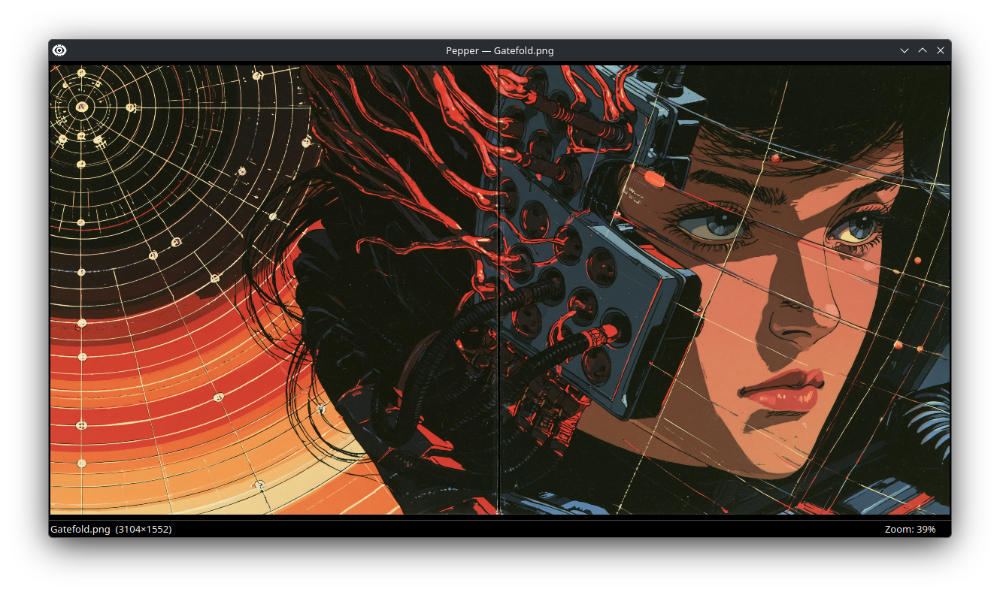
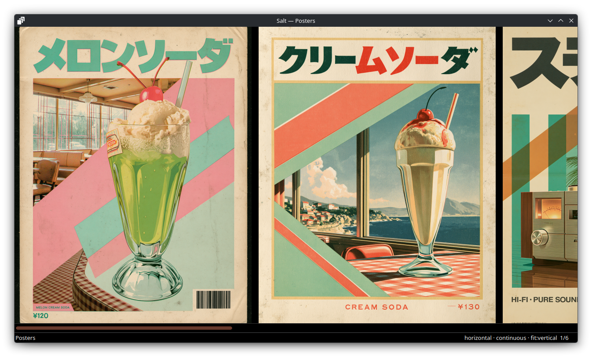

# Pepper and Salt

A standalone image viewer and a gallery viewer for the Linux desktop, sharing one core.



Pepper opens one image and gets out of the way: no toolbar, no library, just
the picture and a status bar you can hide. Salt opens a comic archive or a
folder of images and scrolls through the set, down the page or side by side.
I built them as a pair for KDE Plasma because I wanted viewers that do one
thing each and keep everything else out of sight: the rest lives in the
right-click menu, including Preferences, where either window can turn
translucent with KWin's blur behind it.

## Features

**Pepper**

- Opens anything Qt and KDE's image plugins can read, including WebP, AVIF, JPEG XL, TIFF, PSD and SVG
- Plays animated GIF and WebP, and draws SVGs sharp even when they fill the screen
- Zoom with the wheel or the keys, actual size, fit to window, and drag to pan
- Opens images at fit, shrink-to-fit or actual size, optionally resizing the window to match

**Salt**

- Opens `.cbz`, `.cbr`, `.zip` and `.tar` archives (plain, gzip, bzip2 or xz), or a folder of images, recognising misnamed archives by their contents
- Reads vertically or side by side, fits to width, height or both, and scrolls continuously or a page at a time
- Decodes pages on demand, so memory stays flat however long the set is
- Spots part-downloaded archives, and points out a zip of issues or a folder of chapters

**Both**

- No menu bar or toolbar: everything is in the right-click menu
- Fullscreen, and a minimal mode that hides the status bar
- Opens files dragged onto the window, and says why one won't open instead of closing
- An optional translucent window with KWin's blur behind it, on Wayland and X11

## Status

Working on Fedora 44 with KDE Plasma 6 on Wayland. Missing: packages (both run
from a checkout) and 7z archives.

## Built with

Python 3 and PySide6 (Qt 6), taken from Fedora's RPMs so the windows run on
Plasma's own Qt: a native Wayland surface, KDE theming and portal file
dialogs, which a PyPI wheel with its own Qt would lose. KDE's image-format
plugins add the extra formats, The Unarchiver's `unar` reads CBR, and
KWindowSystem, called through ctypes, provides the blur.

| Directory | What it is |
|---|---|
| `pepper/` | The image viewer |
| `salt/` | The gallery viewer |
| `viewer_core/` | Shared appearance settings, KWin blur and the Window preferences group |

## Build and run

Tested on Fedora 44 with KDE Plasma 6 on Wayland.

```bash
sudo dnf install -y \
    python3-pyside6 qt6-qtwayland qt6-qtsvg qt6-qtimageformats \
    kf6-kimageformats kf6-kwindowsystem unar python3-pytest

git clone https://github.com/jacksonvw/pepper.git
cd pepper
bin/pepper photo.jpg        # an image
bin/salt comic.cbz          # an archive, or a folder of images
```

Everything runs on the system Python against Fedora RPMs, deliberately with
no venv, which is why the launchers pin `/usr/bin/python3`. Logs go to
`/tmp/pepper.log` and `/tmp/salt.log`; settings live in `~/.config/pepper/`
and `~/.config/salt/`.

| Package | Provides |
|---|---|
| `qt6-qtwayland` | A native Wayland window rather than XWayland |
| `qt6-qtsvg`, `qt6-qtimageformats`, `kf6-kimageformats` | SVG, WebP, TIFF, AVIF, JPEG XL, PSD and other formats |
| `kf6-kwindowsystem` | KWin blur-behind; without it the blur is skipped |
| `unar` | Reading `.cbr` / RAR comics, from Fedora's own repos |
| `python3-pytest` | The test suite |

`desktop/install.sh` links `bin/pepper` and `bin/salt` into `~/bin`,
installs both desktop entries and icons, and makes Pepper the default for
PNG, JPEG, GIF, BMP, WebP, TIFF and SVG, and Salt the default for `.cbz`,
`.cbr` and tar, gzip, bzip2 and xz files. Plain `.zip` files and folders
keep their current handlers, with Salt offered under Open With. The script
needs no root and is safe to re-run, including after moving the checkout.

| Key | Pepper | Salt |
|---|---|---|
| Ctrl+O | Open an image | Open an archive or image |
| Ctrl+Shift+O | | Open a folder |
| Ctrl+= / Ctrl+- | Zoom in / out (the wheel zooms too) | |
| Ctrl+0 | Actual size | |
| PgDown / PgUp | | Next / previous page |
| F11 | Toggle fullscreen | Toggle fullscreen |
| Esc | Leave fullscreen | Leave fullscreen |
| Ctrl+H | Hide or show the status bar | Hide or show the status bar |
| Ctrl+Q | Quit | Quit |

In Pepper, fit-to-window is in the right-click menu, and dragging pans a
zoomed-in image. In Salt, orientation, fit and scroll mode are in the
right-click menu. In page scroll mode the wheel and the Up/Down keys scroll
through a page and turn it at the top or bottom, and the other arrow keys
turn it straight away.

The tests run headless, on Qt's offscreen platform:

```bash
/usr/bin/python3 -m pytest
```

## More screenshots



---

Jackson Vander Wal · [jacksonv.com](https://jacksonv.com)
